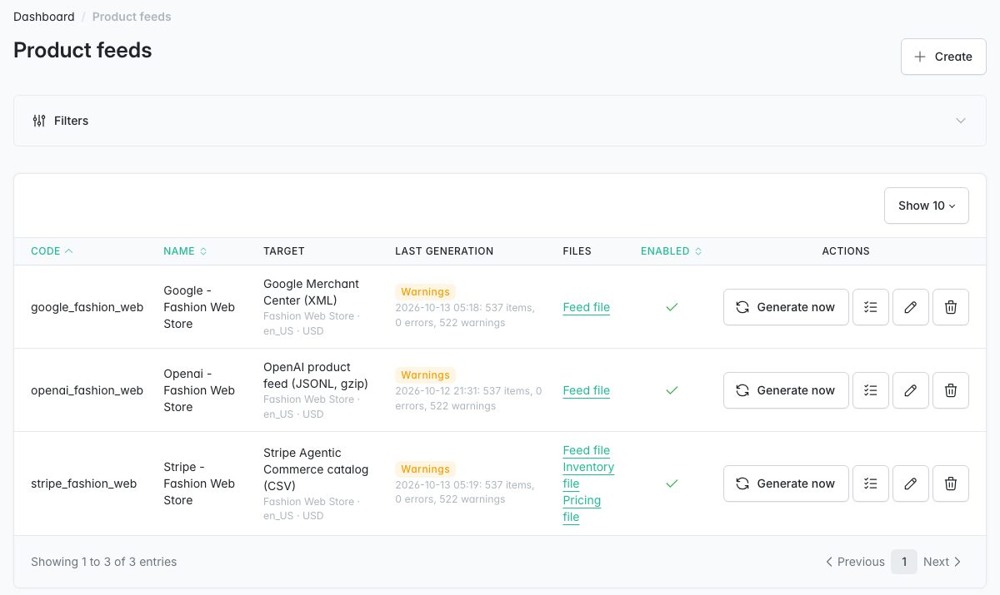
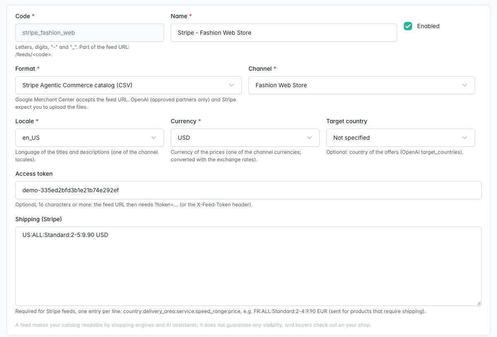
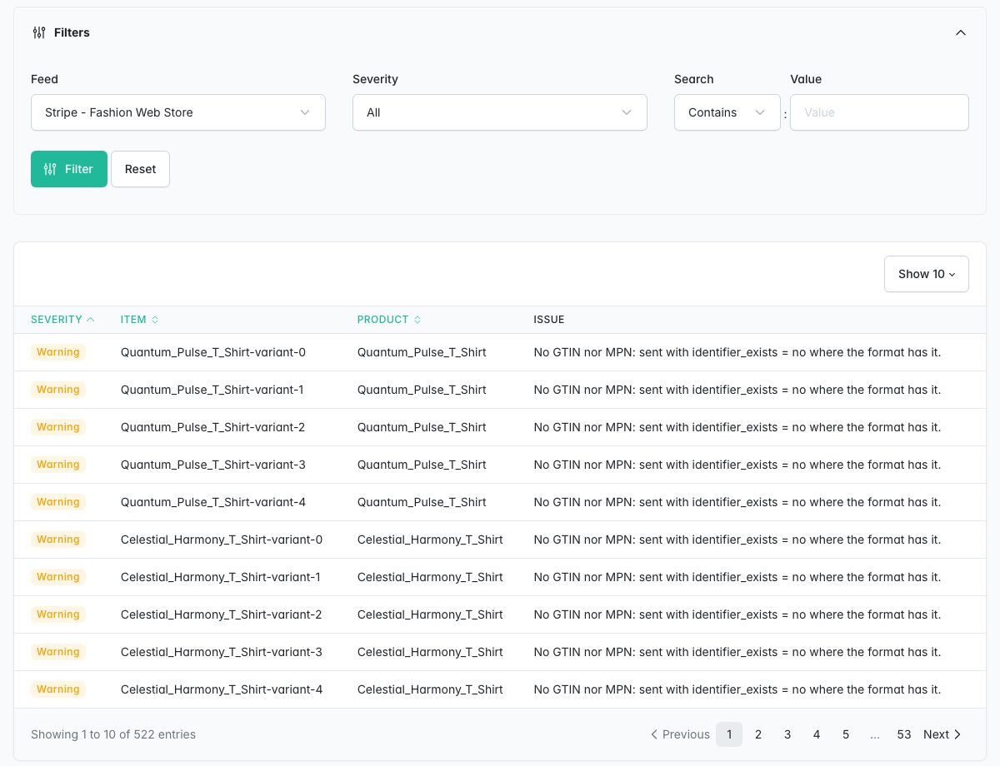

# Agentic Feeds pour Sylius

> English: [README.md](README.md) <!-- vitrine:lang -->

[](https://github.com/thibmonier/sylius-agentic-feeds-plugin/actions/workflows/build.yaml)
[](LICENSE)

**Flux produits pour les moteurs d'achat et les assistants IA dans Sylius 2 : Google Merchant Center
(XML ou TSV), le flux produits OpenAI (JSON Lines, gzip) et le catalogue Stripe Agentic Commerce
(CSV), ainsi que le JSON-LD schema.org Product sur les pages produit.**

Rendez votre catalogue lisible par Google Shopping, ChatGPT shopping et les agents connectés à
Stripe, à partir des données que vous avez déjà dans Sylius : un flux par canal, locale, devise et
format, validé article par article, régénéré lorsque le catalogue change, servi à une URL stable.

Ce que ce plugin n'est **pas** : il ne place pas de tunnel de commande dans ChatGPT, Gemini ou
Copilot, et il ne garantit pas que vos produits apparaissent où que ce soit. Voir [À quoi vous attendre](#à-quoi-vous-attendre).

## Fonctionnalités

| Besoin | Ce que fait le plugin |
|---|---|
| Google Merchant Center | XML RSS 2.0 avec l'espace de noms `g:`, ou fichier séparé par des tabulations : identifiants, titres, descriptions en texte brut, liens, images, disponibilité, prix, prix soldé et dates, marque, GTIN, MPN, `identifier_exists`, état, `item_group_id`, `product_type`, couleur, taille, poids d'expédition. |
| Flux produits OpenAI | JSON Lines compressé en gzip, noms de champs OpenAI (`item_id`, `url`, `image_url`, `group_id`, `variant_dict`, `seller_name`...), `is_eligible_search: true`, `is_eligible_checkout: false` (les acheteurs passent commande sur votre boutique), politique de retour et URL vendeur facultatives par canal. |
| Stripe Agentic Commerce | CSV du catalogue produits avec les entrées d'expédition du flux, plus les CSV de stock et de prix que Stripe accepte toutes les 15 minutes. |
| Un flux par marché | Canal, locale, devise (convertie avec les taux de change Sylius) et pays cible par flux ; autant de flux que nécessaire. |
| Prix corrects | Les prix affichés par votre boutique, dans la devise du flux (un flux échoue plutôt que de publier des montants non convertis faute de taux de change) ; hors taxes dans les flux États-Unis et Canada. Un prix soldé uniquement lorsqu'une promotion de catalogue s'applique **et** que Sylius connaît le prix le plus bas des 30 jours précédents (Omnibus UE) : jamais un « prix d'origine » barré saisi à la main. |
| Variantes | Un article par variante activée, regroupé par produit (`item_group_id` / `group_id`), options sous forme de couleur, taille ou attributs de variante. |
| Identifiants | GTIN et MPN par variante (formulaire de variante, `tmonier:feeds:import-identifiers`), attributs produit pour les produits sans variantes, attribut de marque ou marque par défaut ; clé de contrôle et préfixes réservés vérifiés, un GTIN n'est jamais répété sur deux articles. |
| Stock | `in_stock` / `out_of_stock` à partir du stock disponible moins le stock bloqué (variantes suivies), quantités dans les fichiers Stripe. |
| Validation | Par article : champs obligatoires manquants, titres et descriptions trop longs, GTIN invalides, identifiants manquants. Les articles en erreur sont exclus et listés ; rapport d'administration par flux ; code de sortie pour la CI. |
| Fraîcheur | Une modification du catalogue (produit, variante, stock, prix, traduction, image, attribut) marque les flux comme périmés : `tmonier:feeds:generate --stale` (cron) ou Symfony Scheduler ne régénère que ceux-là. |
| Deltas | Avec [tmonier/sylius-webhook-outbox-plugin](https://github.com/thibmonier/sylius-webhook-outbox-plugin) : événements `product_variant.price_changed` (les changements de stock sont son `product_variant.stock_changed`). |
| Diffusion | URL stables `/feeds/{code}` (et `/feeds/{code}/inventory`, `/feeds/{code}/pricing`), jeton d'accès facultatif (en-tête `X-Feed-Token`), `Last-Modified` / 304, fichiers dans un répertoire local ou sur n'importe quel stockage Flysystem ; les flux des canaux désactivés ne sont ni générés ni servis. |
| Pages produit | `Product` schema.org avec une `Offer` par variante (JSON-LD), omis lorsque la page contient déjà un JSON-LD Product. |
| Administration | *Marketing > Flux produits* : configurations, statut et décomptes de la dernière génération, liens de téléchargement, « Générer maintenant », problèmes par flux. |

Également inclus : traductions en anglais, français, allemand, espagnol, italien, néerlandais et
polonais ; messages Messenger ; fixtures de démonstration ; prise en charge de MySQL, MariaDB et PostgreSQL.

## À quoi vous attendre

- **De la découverte, pas un tunnel de commande.** Les flux rendent votre catalogue lisible par les
  moteurs d'achat et les assistants IA. Les acheteurs sont redirigés vers vos pages produit et
  passent commande sur votre boutique, où s'appliquent vos mentions légales, votre recueil du
  consentement et vos parcours de paiement.
- **Aucune garantie de visibilité.** Google, OpenAI et Stripe décident de ce qu'ils affichent. Google
  examine les produits au regard de ses règles ; OpenAI indique qu'un flux ne garantit pas le placement.
- **OpenAI est restreint.** L'intégration de flux produits dans ChatGPT est réservée aux partenaires
  approuvés par OpenAI (candidature sur chatgpt.com/merchants), et OpenAI attend des fichiers
  poussés par SFTP : ce plugin génère le fichier, il ne l'envoie pas.
- **Stripe** Agentic Commerce exige que Stripe traite vos paiements et votre approbation de
  chaque agent ; vous envoyez les fichiers (Dashboard ou API). Ce plugin n'appelle pas Stripe.
- **Google Merchant Center** récupère l'URL du flux selon la fréquence que vous définissez dans Merchant Center.
- Ce n'est pas de la « vente dans ChatGPT / Gemini » : cela n'est pas disponible aujourd'hui pour les marchands européens.

## Captures d'écran







## Prérequis

| | Version |
|---|---|
| PHP | 8.2+ (Sylius 2.2), 8.3+ (Sylius 2.3) |
| Sylius | 2.2, 2.3 |
| Symfony | 6.4, 7.4 (Sylius 2.2) ; 6.4, 7.4, 8.0 (Sylius 2.3, Symfony 8 nécessite PHP 8.4) |

## Installation

1. Requérez le paquet :

    ```bash
    composer require tmonier/sylius-agentic-feeds-plugin
    ```

2. Enregistrez le bundle dans `config/bundles.php` (Symfony Flex le fait automatiquement dès qu'une recette existe) :

    ```php
    Tmonier\SyliusAgenticFeedsPlugin\TmonierSyliusAgenticFeedsPlugin::class => ['all' => true],
    ```

3. Importez la configuration dans `config/packages/tmonier_sylius_agentic_feeds.yaml` :

    ```yaml
    imports:
        - { resource: "@TmonierSyliusAgenticFeedsPlugin/config/config.yaml" }
    ```

4. Importez les routes (pages d'administration et URL publiques `/feeds/...`) dans
   `config/routes/tmonier_sylius_agentic_feeds.yaml` :

    ```yaml
    tmonier_sylius_agentic_feeds:
        resource: "@TmonierSyliusAgenticFeedsPlugin/config/routes.yaml"
    ```

5. Exécutez les migrations :

    ```bash
    bin/console doctrine:migrations:migrate
    ```

6. Créez les flux dans *Marketing > Flux produits*, puis générez-les depuis cron :

    ```cron
    */15 * * * * bin/console tmonier:feeds:generate --stale
    0 3 * * *    bin/console tmonier:feeds:generate
    ```

## Configuration

```yaml
# config/packages/tmonier_sylius_agentic_feeds.yaml
tmonier_sylius_agentic_feeds:
    storage:
        adapter: local                      # local | flysystem
        directory: '%kernel.project_dir%/var/agentic_feeds'
        flysystem_service: null             # e.g. a league/flysystem-bundle storage service id
    attributes:                             # product attribute codes, null to disable
        gtin: gtin
        mpn: mpn
        brand: brand
    default_brand: null                     # brand of products without brand attribute
    condition: new                          # new | refurbished | used
    link_parameters: 'utm_medium=feed&utm_source={format}'
    batch_size: 100
    json_ld: true
    schedule:
        enabled: false                      # with symfony/scheduler: regenerate stale feeds
        frequency: '1 hour'
    webhook_events: true                    # with tmonier/sylius-webhook-outbox-plugin
    seller_policies:                        # OpenAI fields, per channel code
        FASHION_WEB:
            return_policy: 'https://shop.example.com/returns'
            return_days: 30
            privacy_policy: 'https://shop.example.com/privacy'
            terms: 'https://shop.example.com/terms'
```

**Marque et identifiants.** Google, OpenAI et Stripe exigent une marque pour la plupart des
produits. Utilisez un attribut produit texte `brand` (ou définissez `default_brand`, par exemple pour votre propre
marque) ; sans marque, les articles sont exclus et signalés. Chaque variante a son propre GTIN (Google : « each variant has
its own GTIN ») : saisissez le GTIN et le MPN dans le formulaire de la variante (le formulaire produit pour les produits simples), ou
importez-les :

```bash
bin/console tmonier:feeds:import-identifiers identifiers.csv --dry-run   # variant_code;gtin;mpn
```

Chaque ligne est d'abord vérifiée (variante connue, présente une seule fois, 3 valeurs au plus, GTIN valide non
répété dans le fichier, MPN de 70 caractères au plus) ; si une seule ligne est rejetée, les erreurs sont
listées avec leurs numéros de ligne et rien n'est écrit.

Les attributs produit `gtin` / `mpn` ne servent que pour les produits sans variantes ; sur les produits
avec variantes, ils ne sont pas répétés (avertissement). Les GTIN invalides (longueur, clé de contrôle, préfixes
réservés 02, 04, 2, 05, 98, 99) et un GTIN déjà utilisé par un autre article sont exclus et
signalés ; les articles Google reçoivent `identifier_exists: no` uniquement lorsque la variante n'a aucun identifiant
(l'attribut est omis lorsqu'un GTIN a été exclu ou n'a pas été répété sur les variantes).

**Prix et taxes.** Les prix des flux sont les prix affichés par votre boutique (les prix du canal, qui
incluent la taxe lorsque le taux de la zone de taxe par défaut du canal est « inclus dans le prix »),
convertis dans la devise du flux avec les taux de change Sylius. Un flux dans une devise sans
taux de change est refusé dans le formulaire et échoue (les fichiers précédents sont conservés) plutôt que de publier des
montants non convertis. Les flux ciblant les États-Unis ou le Canada reçoivent des prix hors taxes (une taxe incluse est
retirée), comme l'exige Google dans ces pays. Ailleurs, Google exige des prix TTC : une boutique dont les
taux ne sont pas inclus dans les prix reçoit un avertissement `price_excludes_tax` par article. Un canal sans
zone de taxe par défaut reçoit un avertissement `tax_unknown` et ses prix sont envoyés hors taxes. La colonne Stripe
`tax_behavior` indique lequel des cas s'applique (`inclusive` / `exclusive`).

**Expédition.** Google : définissez l'expédition dans le compte Merchant Center (recommandé par Google).
Stripe exige une valeur `shipping` pour les biens physiques : saisissez les entrées d'expédition du flux
(une par ligne, `country:delivery_area:service:speed_range:price`, par exemple
`FR:ALL:Standard:2-4:9.90 EUR`, ou `US:ALL:Standard::5.00 USD` sans plage de délai) ; elles sont obligatoires pour les flux Stripe et envoyées pour les variantes
qui nécessitent une expédition.

**Soldes (Omnibus).** Un produit affiche un prix réduit uniquement lorsqu'une promotion de catalogue s'y applique
et que le canal affiche le prix le plus bas avant remises (historique des prix Sylius) : le prix du flux
est ce prix le plus bas sur 30 jours, le prix soldé est le prix actuel, avec les dates de la
promotion. Sinon, le prix actuel est le seul prix. Le format de prix Stripe exige une date
de fin : les promotions sans date de fin sont envoyées comme prix, sans prix soldé.

**Stockage.** Le répertoire local doit être partagé entre vos nœuds web et worker ; sinon, utilisez
Flysystem (S3, SFTP...) :

```yaml
flysystem:
    storages:
        feeds.storage:
            adapter: 'aws'
            options: { client: 'aws_client', bucket: 'my-feeds' }

tmonier_sylius_agentic_feeds:
    storage:
        adapter: flysystem
        flysystem_service: feeds.storage
```

### Flux

| Champ | Notes |
|---|---|
| Code | lettres, chiffres, `-`, `_` ; l'URL est `/feeds/{code}` |
| Canal, locale, devise | la locale et la devise doivent être activées dans le canal |
| Pays cible | facultatif (OpenAI `target_countries`) |
| Format | `google_xml`, `google_tsv`, `openai_jsonl`, `stripe_csv` |
| Jeton d'accès | facultatif, 16 caractères ou plus : l'en-tête `X-Feed-Token` (recommandé) ou `?token=...` est alors requis (404 sinon). Les chaînes de requête se retrouvent dans les journaux du serveur web, du proxy et du CDN : préférez l'en-tête lorsque le consommateur le permet, et renouvelez le jeton s'il a fuité |
| Entrées d'expédition | Flux Stripe : un `country:delivery_area:service:speed_range:price` par ligne |

Fichiers : `{code}.xml`, `{code}.tsv`, `{code}.jsonl.gz`, `{code}.csv`, `{code}-inventory.csv`,
`{code}-pricing.csv`. Une génération en échec conserve les fichiers précédents.

### Commande

```bash
bin/console tmonier:feeds:generate                   # every enabled feed
bin/console tmonier:feeds:generate google_web -v     # one feed, list the issues
bin/console tmonier:feeds:generate --stale           # only feeds whose catalog changed
bin/console tmonier:feeds:generate --dry-run --fail-on-errors   # CI: exit 1 if items are left out
```

### Messenger et planification

`Tmonier\SyliusAgenticFeedsPlugin\Message\GenerateFeed` (un flux) et `GenerateStaleFeeds` sont
dispatchés sur `sylius.command_bus` (« Générer maintenant » dans l'administration). Ils s'exécutent de façon synchrone
sauf si vous les routez vers un transport :

```yaml
framework:
    messenger:
        routing:
            'Tmonier\SyliusAgenticFeedsPlugin\Message\GenerateFeed': async
```

Avec `symfony/scheduler` installé et `schedule.enabled: true`, la planification
`tmonier_agentic_feeds` dispatche `GenerateStaleFeeds` à chaque `frequency`
(`bin/console messenger:consume scheduler_tmonier_agentic_feeds`).

### Événements webhook

Avec [tmonier/sylius-webhook-outbox-plugin](https://github.com/thibmonier/sylius-webhook-outbox-plugin),
il est possible de s'abonner au type d'événement `product_variant.price_changed` (version 1) :

```json
{"channel": "FASHION_WEB", "variants": [{"code": "TSHIRT-M", "product_code": "TSHIRT", "price": 1250, "original_price": null, "previous_price": 1000, "previous_original_price": null}]}
```

Montants en unités mineures de la devise de base du canal, un événement par canal et par flush.

### JSON-LD

La page produit reçoit un `<script type="application/ld+json">` avec un `Product` schema.org
(nom, description, images, marque, sku) et une `Offer` par variante activée (prix, devise,
disponibilité, état, GTIN, MPN, `priceValidUntil` pendant une promotion), dans la
locale et la devise du visiteur. Lorsque la page contient déjà un JSON-LD Product (thème, autre plugin),
celui-ci est retiré. Définissez `json_ld: false` pour le désactiver.

## Captures d'écran

`docs/images/` est réservé aux captures d'écran (pas encore incluses) : liste des flux avec statuts et
liens de téléchargement, formulaire de flux, rapport de problèmes, XML généré.

## Limitations

- Les fichiers sont générés, pas poussés : pas d'envoi SFTP vers OpenAI, pas d'appel à l'API d'import de Stripe.
- Pas de parquet (le format préféré d'OpenAI), pas de push vers l'API Feed d'OpenAI, pas de flux de promotions.
- Les attributs d'expédition et de taxe Google ne sont pas envoyés (paramètres du compte Merchant Center).
- OpenAI : `target_countries` uniquement pour les États-Unis, le Canada et le Mexique (les marchés du format).
- Un article par variante ; les images de la variante sont listées en premier, puis celles du produit.
- Les URL d'images pointent vers les fichiers d'origine (`/media/image/...`) ; Google exige
  au moins 500 x 500 pixels à partir du 2027-01-31.

## Développement

Voir `CLAUDE.md` pour l'environnement local et les commandes, `SPEC.md` pour les spécifications lues
et les décisions de conception.

<!-- vitrine:demo-b2b:start -->
## Démo B2B

Ce plugin est utilisé dans la [démo B2B Sylius](https://github.com/thibmonier/sylius-b2b-demo) : une boutique Sylius 2.3 avec des données d'exemple fictives, où les plugins B2B fonctionnent ensemble. Le code source, l'installation et les fixtures de la démo sont dans ce dépôt.

La démo est un exemple, pas une configuration de production.
<!-- vitrine:demo-b2b:end -->

## Licence

MIT, voir [LICENSE](LICENSE).
